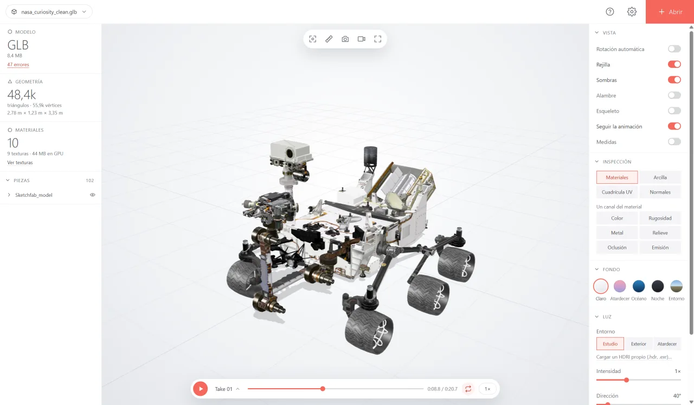

# Visor 3D

**English** · [Castellano](#castellano)

A 3D model viewer for Windows, Linux, Mac and the browser: drop a model in and
see it, with its textures and animations.

**Download:** [Windows](https://github.com/enaraartetxe/viewer-3d/releases/latest/download/Visor-3D.exe)
· [Linux](https://github.com/enaraartetxe/viewer-3d/releases/latest/download/Visor-3D-linux-x64.tar.gz)
· [Mac](https://github.com/enaraartetxe/viewer-3d/releases/latest/download/Visor-3D-mac.zip) (not tested on a real Mac yet)
· **[Use it in the browser](https://enaraartetxe.com/experimentos/viewer-3d/)**

One file per system, no installer, works offline. The interface is in English
and Spanish: it follows the system's language, and it can be changed from the
gear icon.

- **Windows 10/11**: it isn't signed, so the first time Windows may warn:
  «More info» → «Run anyway».
- **Linux x64**: needs WebKitGTK (`sudo apt install libwebkit2gtk-4.1-0` on
  Ubuntu/Debian/Mint, `sudo dnf install webkit2gtk4.1` on Fedora).
- **macOS 11+**: not signed by Apple. After the first attempt to open it:
  System Settings → Privacy & Security → «Open Anyway».

## What it does

- Opens GLB and glTF (also compressed with Draco, Meshopt or KTX2), ZIP files
  with a glTF inside, FBX, OBJ, STL, DAE, USDZ, 3MF and PLY.
- Animations: pick one, chain them all, loop, speed. If they move the model,
  the camera follows it.
- Inspection: clay, UV grid, normals and each material channel (colour,
  roughness, metalness, normal map, occlusion, emission).
- HDRI environments (built-in or your own), backgrounds, light and effects
  (ambient occlusion, bloom, depth of field).
- The model's parts (hide, frame), morph targets and the file's cameras.
- Dimensions, a ruler between two points, glTF validation with Khronos'
  official validator and a texture report.
- PNG screenshots and a video turning around the model.
- Light, dark and high-contrast themes; English and Spanish.
- On Windows and Linux: open models with a double click (from the gear icon)
  and recent files.

## How it's made

Plain HTML, CSS and JavaScript (no build step), with
[three.js](https://threejs.org). The desktop apps are the same page inside a
[Neutralino](https://neutralino.js.org) window.

- `index.html`, `estilo.css`, `main.js`: the app; `idiomas.js`: its texts in
  Spanish and English. To try it, serve the folder with any local server (for
  example `npx servez`).
- `escritorio/`: desktop packaging. `escritorio/empaquetar.sh` builds the apps
  into `escritorio/salida/`; details in [escritorio/README.md](escritorio/README.md).
- Releases are automatic: when the version in
  `escritorio/neutralino.config.json` changes, GitHub Actions builds the three
  apps on a Mac runner and publishes them
  ([.github/workflows/publicar.yml](.github/workflows/publicar.yml)).

## Made with AI

Idea, design, direction and testing: Enara Artetxe. Code written with
**Claude Opus 5.5** (Anthropic), credited as co-author in the commits.

## Licences

Code under the [MIT](LICENSE) licence. It includes or downloads:

- [three.js](https://github.com/mrdoob/three.js) (MIT).
- [Neutralino](https://github.com/neutralinojs/neutralinojs) (MIT).
- [glTF-Validator](https://github.com/KhronosGroup/glTF-Validator) by Khronos
  (Apache 2.0).
- The HDRI environments are from [Poly Haven](https://polyhaven.com) (CC0); see
  [entornos/CREDITOS.md](entornos/CREDITOS.md).
- Model in the picture: [Curiosity Rover 3D Model](https://science.nasa.gov/resource/curiosity-rover-3d-model/), by NASA.

---

## Castellano

Visor de modelos 3D para Windows, Linux, Mac y el navegador: arrastras un
modelo y lo ves, con sus texturas y animaciones.

**Descargar:** [Windows](https://github.com/enaraartetxe/viewer-3d/releases/latest/download/Visor-3D.exe)
· [Linux](https://github.com/enaraartetxe/viewer-3d/releases/latest/download/Visor-3D-linux-x64.tar.gz)
· [Mac](https://github.com/enaraartetxe/viewer-3d/releases/latest/download/Visor-3D-mac.zip) (sin probar todavía en un Mac de verdad)
· **[Usar en el navegador](https://enaraartetxe.com/experimentos/viewer-3d/)**

Un archivo por sistema, sin instalador y sin conexión. La interfaz está en
inglés y en castellano: sigue el idioma del sistema, y se puede cambiar desde
el engranaje.

- **Windows 10/11**: no está firmado; la primera vez Windows puede avisar:
  «Más información» → «Ejecutar de todas formas».
- **Linux x64**: necesita WebKitGTK (`sudo apt install libwebkit2gtk-4.1-0` en
  Ubuntu/Debian/Mint, `sudo dnf install webkit2gtk4.1` en Fedora).
- **macOS 11+**: no está firmado por Apple. Tras el primer intento de abrirlo:
  Ajustes del Sistema → Privacidad y seguridad → «Abrir igualmente».

### Qué hace

- Abre GLB y glTF (también comprimidos con Draco, Meshopt o KTX2), ZIP con un
  glTF dentro, FBX, OBJ, STL, DAE, USDZ, 3MF y PLY.
- Animaciones: elegir, encadenar todas, repetir, velocidad. Si mueven el
  modelo, la cámara lo sigue.
- Inspección: arcilla, cuadrícula UV, normales y cada canal del material
  (color, rugosidad, metal, relieve, oclusión, emisión).
- Entornos HDRI (incluidos o el tuyo), fondos, luz y efectos (oclusión
  ambiental, resplandor, desenfoque).
- Piezas del modelo con ocultar y encuadrar, formas (morph targets) y cámaras
  del archivo.
- Medidas, regla entre dos puntos, validación glTF con el validador oficial de
  Khronos e informe de texturas.
- Captura en PNG y vídeo girando alrededor del modelo.
- Temas claro, oscuro y alto contraste; inglés y castellano.
- En Windows y Linux: abrir los modelos con doble clic (desde el engranaje) y
  archivos recientes.

### Cómo está hecho

HTML, CSS y JavaScript sin compilar, con [three.js](https://threejs.org). Los
programas de escritorio son la misma página dentro de una ventana de
[Neutralino](https://neutralino.js.org).

- `index.html`, `estilo.css`, `main.js`: la aplicación; `idiomas.js`: sus
  textos en castellano e inglés. Para probarla, sirve la carpeta con cualquier
  servidor local (por ejemplo `npx servez`).
- `escritorio/`: empaquetado de escritorio. `escritorio/empaquetar.sh` genera
  los programas en `escritorio/salida/`; detalles en
  [escritorio/README.md](escritorio/README.md).
- Las versiones se publican solas: al cambiar la versión de
  `escritorio/neutralino.config.json`, GitHub Actions genera los tres programas
  en un Mac y los publica ([.github/workflows/publicar.yml](.github/workflows/publicar.yml)).

### Hecho con IA

Idea, diseño, dirección y pruebas: Enara Artetxe. Código escrito con
**Claude Opus 5.5** (Anthropic), que figura como coautor en los commits.

### Licencias

Código bajo licencia [MIT](LICENSE). Incluye o descarga:

- [three.js](https://github.com/mrdoob/three.js) (MIT).
- [Neutralino](https://github.com/neutralinojs/neutralinojs) (MIT).
- [glTF-Validator](https://github.com/KhronosGroup/glTF-Validator) de Khronos
  (Apache 2.0).
- Los entornos HDRI son de [Poly Haven](https://polyhaven.com) (CC0); ver
  [entornos/CREDITOS.md](entornos/CREDITOS.md).
- Modelo de la imagen: [Curiosity Rover 3D Model](https://science.nasa.gov/resource/curiosity-rover-3d-model/), de la NASA.
